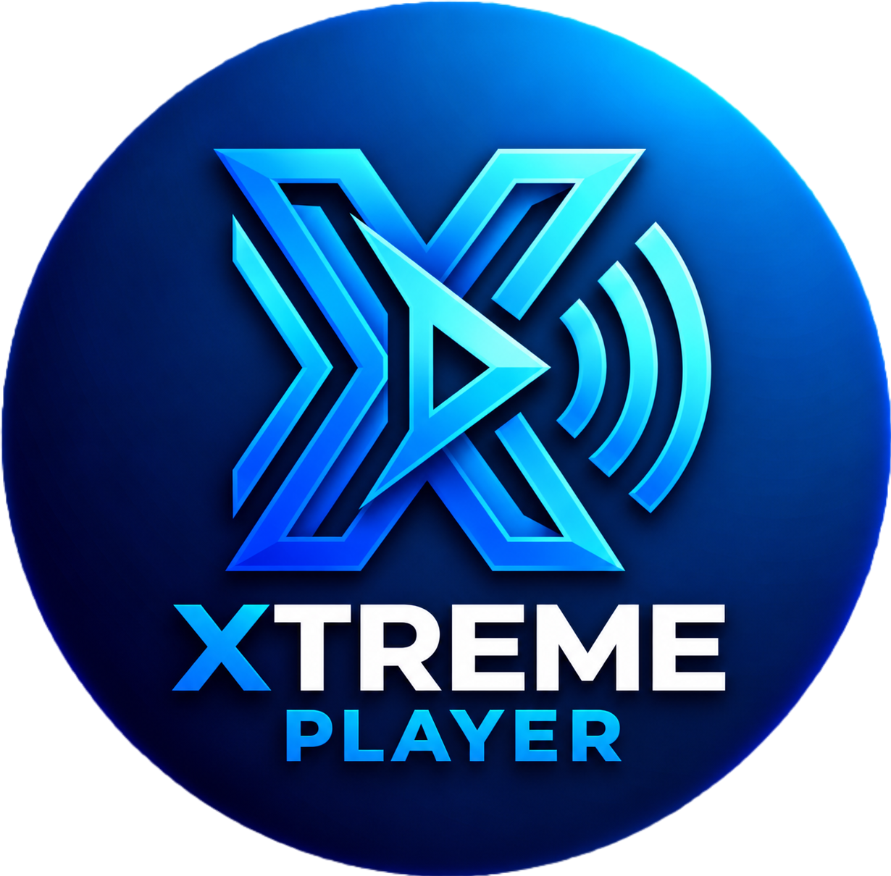
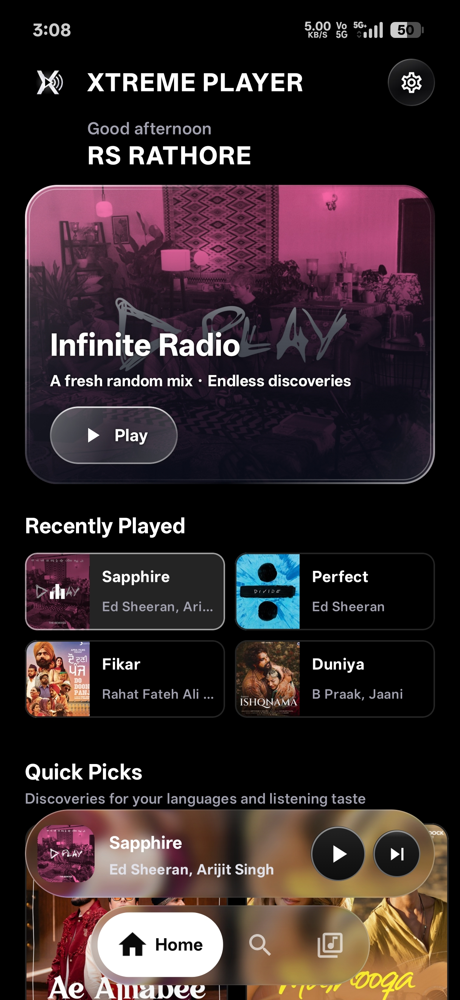
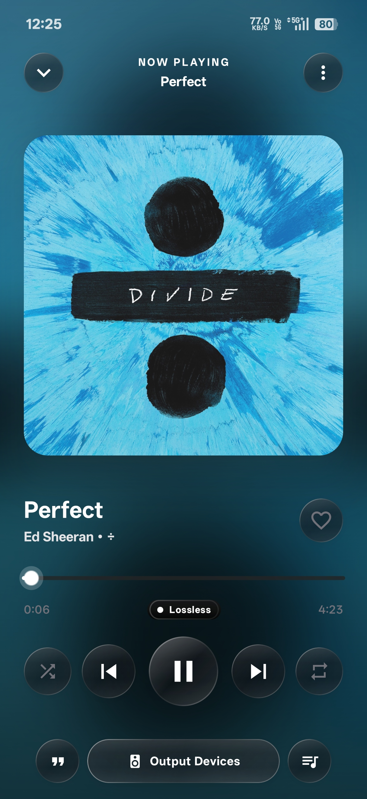
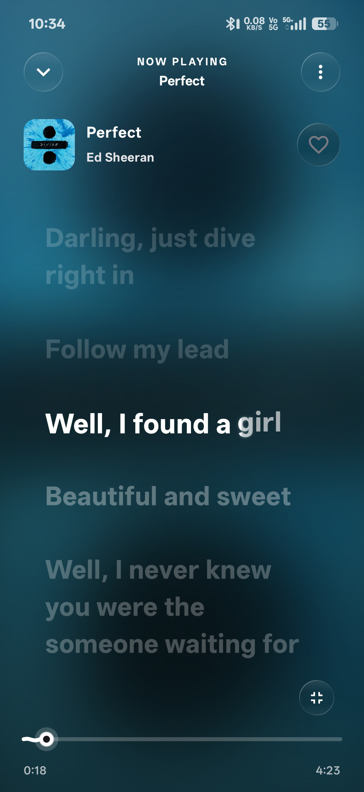
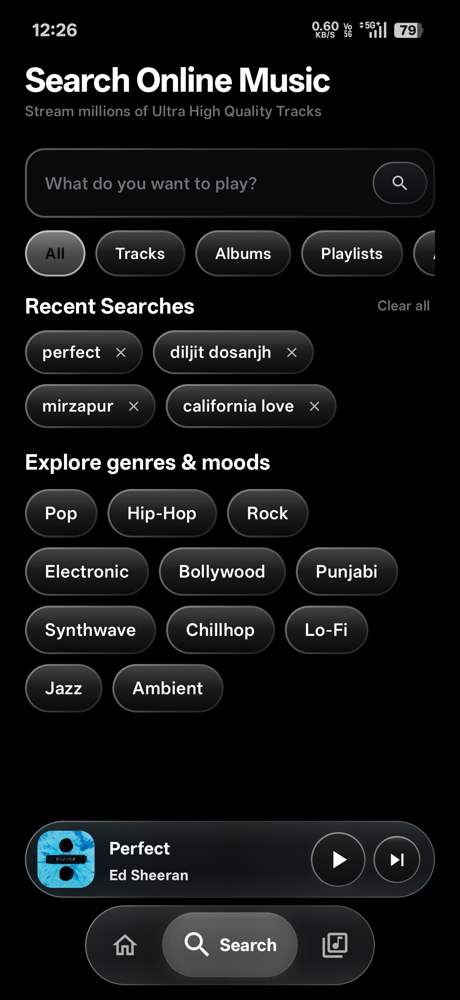
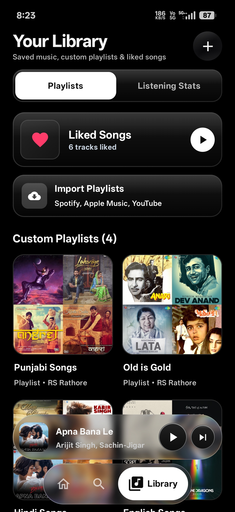
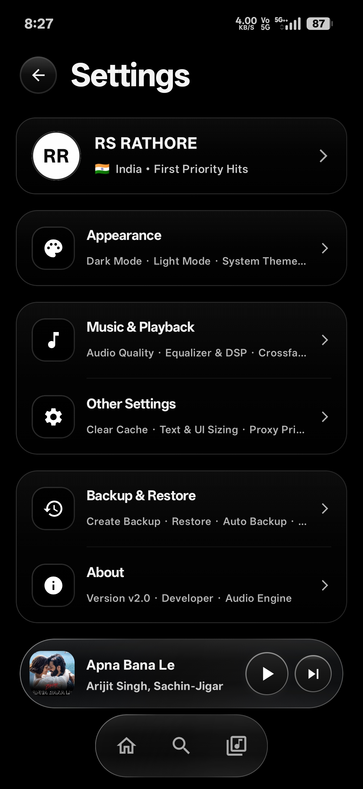
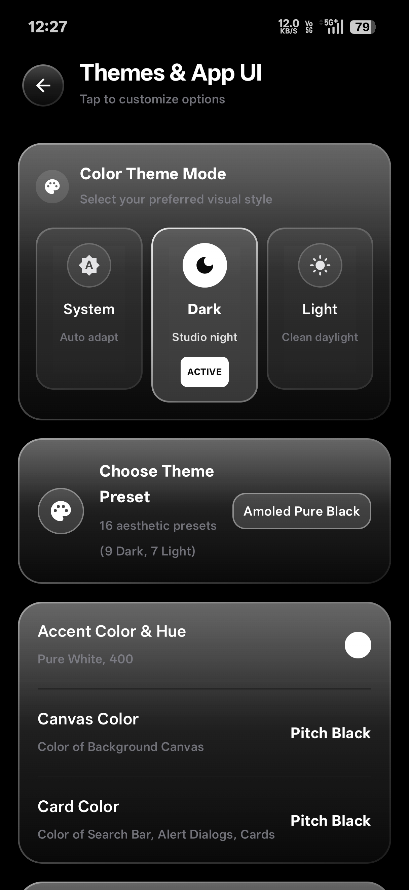
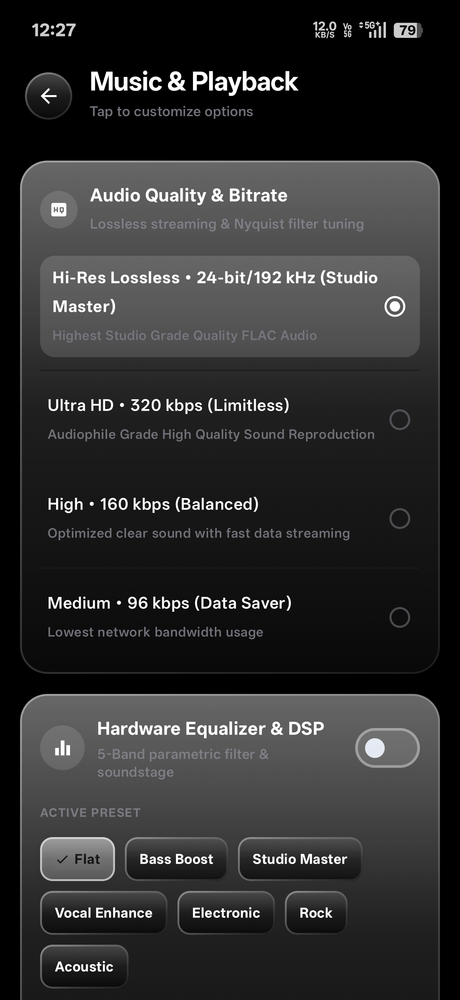

<div align="center">

  <!-- Centered Circular App Logo -->
  <a href="https://github.com/rsrathore2196/Xtreme-Player">
    
  </a>

  <!-- Project Title -->
  <h1> Xtreme Player</h1>

  <!-- Short Overview -->
  <p>
    <b>Xtreme Player</b> is a lightweight, modern, open-source online streaming YouTube Music Client for Android. Built with a clean Material You (Material 3) interface, it delivers an ad-free, high-fidelity music experience with seamless streaming and local library support.
  </p>
  <p>
    Stream millions of online tracks in studio-grade <b> Lossless and FLAC high-res audio</b>, manage custom libraries, and enjoy seamless playback without interruptions.
  </p>

  <!-- Badges -->
  <p>
    <a href="https://github.com/rsrathore2196/Xtreme-Player/releases"></a>
    <a href="https://github.com/rsrathore2196/Xtreme-Player/releases/latest"></a>
    <a href="#"></a>
  </p>

  <p>
    <a href="https://t.me/XtremePlayerOfficiaI"></a>
    <a href="https://t.me/xtremeplayerofficial"></a>
  </p>

  <p>
    <a href="https://buymeachai.ezee.li/RSRathore"></a>
  </p>

  <!-- Quick Navigation -->
  <p>
    <a href="#-app-interface">App Interface</a> •
    <a href="#-key-features">Key Features</a> •
    <a href="#-built-with">Built With</a> •
    <a href="#-getting-started">Getting Started</a>
  </p>

</div>

---

## 📸 App Interface

<div align="center">
  <table>
    <tr>
      <td align="center" width="25%">
        <br />
        <b>Home View</b>
      </td>
      <td align="center" width="25%">
        <br />
        <b>Now Playing</b>
      </td>
      <td align="center" width="25%">
        <br />
        <b>Synced Lyrics</b>
      </td>
      <td align="center" width="25%">
        <br />
        <b>Music Search</b>
      </td>
    </tr>
    <tr>
      <td align="center" width="25%">
        <br />
        <b>Your Library</b>
      </td>
      <td align="center" width="25%">
        <br />
        <b>Settings Hub</b>
      </td>
      <td align="center" width="25%">
        <br />
        <b>Themes & UI</b>
      </td>
      <td align="center" width="25%">
        <br />
        <b>Audio & DSP</b>
      </td>
    </tr>
  </table>
</div>

---

## ✨ Key Features

### 🎧 Premium Streaming & Audio Engine
- **Hi-Res Lossless & HQ Listening:** Enjoy FLAC, WAV, AAC, and bitrate tiers up to 24-bit/192 kHz studio master quality, with adjustable audio quality settings for mobile or high-fidelity listening.
- **Audio DSP & Equalizer:** Tune playback with a 5-band hardware equalizer, preset modes including Flat, Bass Boost, Studio Master, Vocal Enhance, Electronic, Rock, and Acoustic, plus Crystal Clear audio enhancement.
- **Gapless, Smooth Playback:** Gapless transitions, 16-bit PCM hardware output, predictive pre-buffering, and a local LRU cache help reduce stutter and lag on weaker connections.
- **Background & Controls:** Persistent lock screen and notification playback controls keep music playing in the background with AndroidX Media3 support.
- **Smart Recommendations:** Discover more relevant tracks, regional chart hits, personalized mixes, and artist-based suggestions without repetitive country tags.
- **Fresh Genre Discovery:** Shuffle through curated genre sessions with better track rotation and new recommendations every time you open a section.

### 🎨 Material You Interface & Customization
- **Modern Material 3 UI:** Clean, glass-inspired layouts with dynamic AMOLED dark mode, light mode, or system theme matching.
- **Custom Themes & Colors:** Choose from 10 curated presets and fine-tune accent, canvas, card, and gradient colors with live visual changes.
- **Player UX & Visuals:** Ambient album glow, dynamic blur/liquid glass effects, high-contrast typography, full-screen player polish, and tactile haptic feedback.
- **Text & Layout Controls:** Adjust text size, UI density, theme mode, and mini-player actions like the favorite heart and next-track control.
- **Adaptive Personalization:** Save your preferred playback and visual settings for a consistent, tailored listening experience.

### 🔍 Search, Library & Discovery
- **Instant Online Search:** Search tracks, artists, albums, and top hits with a fast, debounced engine.
- **Personalized Library:** Save favorites, track listening history, revisit recently played music, and follow most-listened artists and curated recommendations.
- **Playlists & Queue:** Create and manage playlists, reorder tracks, shuffle, loop, and resume playback without interruption.
- **Import from Other Services:** Import playlists from Spotify, Apple Music, Amazon Music, and custom local music sources.
- **Home & Discovery Cards:** Explore trending tracks, personalized mixes, country/language recommendations, and inspired song sections from the Home screen.

### 🧰 Smart Settings, Backup & Privacy
- **Smart Storage & Cache:** Clear cache, smart auto-trim, configure cache quotas, and run one-tap optimization to keep storage under control.
- **Backup & Restore:** Create backups of playlists, library entries, and preferences, restore them from phone storage, and automate backups to a chosen folder.
- **Privacy & Proxy Controls:** Use proxy settings and privacy-conscious preferences without invasive tracking or unnecessary permissions.
- **Accessibility & Comfort:** Scale text and app density to fit your screen and preference, with extra UI personalization and haptic feedback.

### 🔓 100% Free & Open Source
- **No Ads, No Paywalls:** Pure music streaming without sponsored interruptions.
- **No Subscription Lock-in:** Full access to the app without monthly fees or premium gates.
- **Privacy-First Design:** No invasive tracking, profiling, or unnecessary permissions.
- **Community-Driven:** Fully open-source codebase open for contributions and audits.

---

## 🛠 Built With

- **Language:** Kotlin
- **UI Toolkit:** Jetpack Compose & Material Design 3
- **Audio Engine:** AndroidX Media3 (ExoPlayer + MediaSessionService)
- **Architecture:** Clean Architecture + MVI / MVVM
- **Database:** Room (Local playlists and metadata caching)
- **Image Loading:** Coil Compose
- **Networking:** Retrofit2 & OkHttp3

---

## 🚀 Getting Started

Home recommendations use anonymous YouTube Music metadata through InnerTubeX, local profile/listening signals,
and verified JioSaavn recording matches. Cached cards render immediately; discovery and matching are bounded,
viewport-driven background work. No recommendation API key is required.
Recently Played and Most Listened Artists continue to use local listening history.

### Prerequisites
- Android Studio Ladybug (2024.2.1 or newer)
- Android SDK 26+ (Android 8.0 Oreo or higher)
- JDK 17+


---

## Disclaimer & Legal Notice

Xtreme Player is an independent, community-driven third-party audio player and client. It is not associated with Google LLC, YouTube Music, Telegram, or any of their parent companies.

- **No Media Hosting:** Xtreme Player does not host, upload, or store copyrighted music files. It operates strictly as an interface to scan local device storage or stream media directly from public, public-facing, or user-authenticated APIs.

- **Fair Use & API Usage:** This software is created solely for personal research, educational, and fair-use purposes. The user is entirely responsible for ensuring their usage aligns with their local copyright laws and YouTube Terms of Service.

**This project is provided for educational and research purposes only. The maintainers do not endorse or facilitate copyright infringement, unauthorized redistribution, or illegal access to media content. Use only in compliance with applicable local laws, platform terms, and licensing requirements.**

---

### Build & Run

```bash
# Clone the repository
git clone https://github.com/rsrathore2196/Xtreme-Player.git

# Navigate to the project directory
cd Xtreme-Player

# Build the debug APK
./gradlew assembleDebug
```
